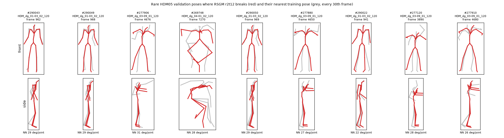

# RSGM r2t12: unstable training and broken densities on rare poses

An issue found when training the best configuration of round 2 of the hyperparameter search (`docs/rsgm_hyperparameter_tuning.md`) at the full budget. The data behind every number here is in `docs/rsgm_rare_poses.json`; the poses are drawn in `docs/figures/rsgm_rare_poses.png`.

## Summary

- **The run.** `~/data/experiments/rsgm_tuned_r2t12/run_0001`: RSGM with MLP 1024 × 5 (silu), lr 1.6e-3, β_f 6.0, `loss_t_min` 1.4e-3, batch 512, EMA 0.999, step schedule, 100k steps on all frames of AMASS (33 min on mps).
- **Symptoms.** From step ~47k the training loss has spikes ("catapults") of 10⁵-10⁶ (median ~6); the validation loss (mean over the 1.32M valid poses) goes from 6.67 at 35k to 3,255 at 100k.
- **It is not overfitting.** The validation mean is dominated by three poses: without the 10 worst of 1.32M poses it is 6.667, the best value of the run. On ordinary poses the model keeps improving: the log-likelihood of valid poses rises until ~80k and then plateaus; the gap between training and validation loss stays the same.
- **The real defect: the density of rare poses breaks down.** On poses far from the training data the network's score at small noise levels explodes, the probability flow ODE diverges, and the log-likelihood becomes numerical garbage (from −6,600 to +7,100 nats instead of ~30-80). It starts at step 40k and spreads. The same happens on rare **training** poses (313 of 14.8M), which is the likely source of the training spikes.
- **Other models are fine.** The default RSGM and the round-1 configuration t23 show nothing of the kind (maximum per-pose loss 170 and 690, against 8·10¹⁰).
- **The numbers so far are not affected.** The objective values of the search have no outliers; on 2,000 test poses no model has an implausible likelihood (r2t12: mean 139.67, the best). But a mean likelihood can be inflated by such garbage: one pose at +5,669 among 5,000 adds 1.1 nats.

## Symptoms

Training loss (per step) and validation loss (mean of the full valid split, EMA weights, fixed noise) of r2t12:

| steps | training loss: median | p99 | max | spikes > 20 |
|---|---|---|---|---|
| 0-10k | 7.32 | 10.9 | 29.8 | 20 |
| 10k-30k | 6.62 | 7.7 | 48.7 | 2 |
| 30k-50k | 6.28 | 7.3 | 5.3·10⁵ | 4 |
| 50k-70k | 6.11 | 7.1 | 1.1·10⁶ | 10 |
| 70k-100k | 5.61 | 6.6 | 4.7·10⁶ | 12 |

The largest spikes: step 80,157 (4.7·10⁶), 98,112 (2.3·10⁶), 88,033 (1.9·10⁶), 56,936 (1.1·10⁶), 82,807 (7.0·10⁵), 47,488 (5.3·10⁵, the first). The learning-rate decay at 70k does not stop them. For comparison, the default RSGM and t23 have no training loss above 25.

Validation loss: 7.02 (5k), 6.82, 6.75, 6.73, 6.71, 6.70, **6.67 (35k)**, 6.67, 6.67, 6.87 (50k), 6.97, 21.7 (60k), 73.7, 523 (70k), 95.9, 507, 651, 283, 449, **3,255 (100k)**. It is not monotone: it jumps with the few poses that break at a given checkpoint.

## Diagnosis

### A few poses carry the validation mean

Recomputing the validation of `Trainer` (the same order of poses, the same noise) with the final EMA weights gives 3,255.6 (the history says 3,255.0). The median per-pose loss is 2.49, the 99.99th percentile 78; **without the 10 worst poses the mean is 6.667**. Three poses carry it: valid #290043 (2.4·10⁹), #290049 (1.5·10⁹), #277906 (4.2·10⁸), all at small noise levels (t = 0.006-0.013).

### Not overfitting

On 8,000 random poses of the c30 valid split and 8,000 of the c30 train split, per-pose losses at the EMA checkpoints (fixed noise):

| checkpoint | train: mean / median | valid: mean / median | poses > 100 | valid log-likelihood (500 poses, 100 ODE steps) |
|---|---|---|---|---|
| 30k | 5.54 / 2.21 | 6.91 / 2.62 | 0 | 133.32 |
| 40k | 5.46 / 2.15 | 6.87 / 2.56 | 0 | 133.85 |
| 60k | 5.36 / 2.12 | 6.87 / 2.54 | 0 | 134.15 |
| 80k | 5.20 / 2.05 | 6.89 / 2.46 | 0 | 134.38 |
| 100k | 5.15 / 2.03 | 6.90 / 2.47 | 0 | 134.27 |

The training loss falls slowly, the validation loss is flat, their gap is constant (the valid datasets are other subjects and other recordings), and the likelihood rises until ~80k. No sign of the model memorizing its training data.

### The poses

Nine of the ten worst validation poses are genuinely rare: their nearest training pose (every 30th frame of the train split, 497k poses) is 26-31° per joint away, while for random HDM05 poses the median is 10.2° and the 99th percentile 21.7°. All are from HDM05, actor `dg`, two short stretches of two recordings plus one more:

| valid # | sequence (in `~/data/amass/HDM05/dg/`) | frame (120 fps) | time | nearest training pose (°/joint) | joints farthest from it |
|---|---|---|---|---|---|
| 290043 | `HDM_dg_01-03_02_120_stageii.npz` | 962 | 8.02 s | 28.8 | RightArm 104°, RightElbow 72°, RightShoulder 65° |
| 290049 | `HDM_dg_01-03_02_120_stageii.npz` | 968 | 8.07 s | 29.2 | RightArm 106°, RightShoulder 67°, RightElbow 61° |
| 290050 | `HDM_dg_01-03_02_120_stageii.npz` | 969 | 8.07 s | 29.2 | RightArm 107°, RightShoulder 66°, RightElbow 61° |
| 290022 | `HDM_dg_01-03_02_120_stageii.npz` | 941 | 7.84 s | 21.6 | RightArm 75°, RightElbow 55°, RightShoulder 51° |
| 277906 | `HDM_dg_03-09_01_120_stageii.npz` | 4676 | 38.97 s | 30.8 | Head 88°, LeftHand 66°, LeftElbow 65° |
| 277880 | `HDM_dg_03-09_01_120_stageii.npz` | 4650 | 38.75 s | 27.0 | RightHand 69°, LeftHand 64°, Head 52° |
| 277910 | `HDM_dg_03-09_01_120_stageii.npz` | 4680 | 39.00 s | 26.2 | Head 67°, RightShoulder 48°, LeftArm 46° |
| 277120 | `HDM_dg_03-09_01_120_stageii.npz` | 3890 | 32.42 s | 27.6 | Head 56°, LeftHand 50°, RightShoulder 46° |
| 269748 | `HDM_dg_04-01_02_120_stageii.npz` | 7270 | 60.58 s | 27.8 | LeftFoot 108°, LeftLeg 62°, RightArm 50° |
| 631354 | `HDM05/bk/HDM_bk_01-04_02_120_stageii.npz` | 2157 | 17.98 s | 9.1 (ordinary) | – |

What they look like (figure): in `HDM_dg_01-03_02` around 8 s the right arm is raised and twisted far back (RightArm 136-143° from the rest pose); in `HDM_dg_03-09_01` the arms are spread and raised with the head tilted; #269748 is a deep squat with the knees spread and a foot turned by 150°. #631354 is an ordinary pose that landed in the top 10 by chance (an unlucky noise draw); its likelihood is normal at every checkpoint.

The full scan (below) adds more frames of the same stretches: `HDM_dg_03-09_01` frames 3881-3888 (32.3-32.4 s) and 4674-4677 (38.95-38.98 s), `HDM_dg_01-03_02` frames 962-968.



### When it breaks

Log-likelihood (EMA weights, 200 ODE steps) of the ten poses above at every checkpoint of r2t12, next to the mean of 200 random HDM05 poses:

| checkpoint | the nine rare poses (order below the table) | 200 random HDM05 poses |
|---|---|---|
| 10k | 58, 56, 40, 76, 57, 50, 69, 47, 51 | 129.06 |
| 20k | 50, 51, 44, 73, 52, 55, 58, 52, 56 | 131.26 |
| 30k | 53, 54, 41, 76, 54, 51, 60, 49, 54 | 131.71 |
| 40k | 49, **−140**, **−213**, 72, 43, 52, 63, 50, 55 | 132.16 |
| 50k | **203**, **1,114**, −54, 74, **948**, 47, 59, 44, 49 | 132.75 |
| 60k | **1,489**, **621**, **1,410**, 72, **−492**, 44, 59, **1,848**, 46 | 132.78 |
| 70k | **1,357**, **2,904**, 31, 69, **−4,785**, 48, **2,597**, **−1,267**, **7,087** | 132.75 |
| 80k | **1,734**, **2,172**, **1,510**, 66, **−6,572**, **1,674**, **3,639**, **1,983**, **−5,774** | 132.71 |
| 90k | **5,040**, **4,716**, **−3,619**, 67, **−2,728**, **−336**, 962, 977, 836 | 132.68 |
| 100k | **2,583**, **−3,360**, **−1,577**, **3,486**, **−1,567**, **5,669**, **4,645**, 53, **−3,271** | 132.38 |

Order of the poses: valid #290043, 290049, 277906, 269748, 290050, 277880, 290022, 277120, 277910 (#631354 is left out: 125-131 at every checkpoint). Up to 30k the rare poses get sane log-likelihoods (40-76, far below ordinary poses, as they should). At 40k two of them break; from 50k almost all, with values that grow and change sign from checkpoint to checkpoint. Meanwhile the ordinary poses improve until 50k and stay flat afterwards. The first training spike (47,488) falls in the same window.

**The broken values are not even reproducible.** The same pose (valid #290043) evaluated four ways, all with 200 ODE steps and the final EMA weights:

| | from the source `.npz` alone (mps) | from `HDM05.pt`, in a batch of six (mps) | from `HDM05.pt` alone (mps) | from `HDM05.pt` alone (cpu) |
|---|---|---|---|---|
| r2t12 | 5,289 | 2,583 | 1,821 | 10,134 |
| RSGM default | 37.0 | 37.0 | 37.0 | 37.0 |

The two inputs differ by 1e-7 (float32 rounding), and the batch and the device only change the floating-point order of operations. A stable model gives the same number every time; r2t12 amplifies these differences by orders of magnitude, so its value at such a pose is chaotic, not just wrong. The tables of this document give the values of one evaluation (the poses in one batch, mps); they show that the density is broken, not what it "is".

Reference models on the same poses:

| model | the nine rare poses | #631354 | 200 random HDM05 poses |
|---|---|---|---|
| RSGM default (all frames) | 37, 37, 30, 77, 38, 41, 59, 37, 43 | 125 | 129.46 |
| RSGM t23 (all frames) | 2.5, 1.4, 22, 65, 1.9, 35, 26, 36, 46 | 122 | 130.62 |
| RSGM r2t12 at 100k | see the last row above | 126 | 132.38 |

t23 is stable, but gives the raised-arm poses of `HDM_dg_01-03_02` a markedly lower likelihood (1.4-2.5) than the default (37): sharper, possibly the beginning of the same effect.

### The full scan

Every pose of the valid split (1.32M) and the train split (14.8M), all frames, the per-pose loss at a fixed small noise level t = 0.01 (seeded noise), with the final EMA weights:

| | poses | median | > 10² | > 10³ | > 10⁴ | > 10⁶ | max |
|---|---|---|---|---|---|---|---|
| valid, r2t12 | 1,320,126 | 51.9 | 1,641 | **138** | 107 | 78 | 4.1·10⁹ |
| valid, t23 | 1,320,126 | 50.8 | 1,832 | 0 | 0 | 0 | 250 |
| valid, default | 1,320,126 | 50.0 | 1,241 | 0 | 0 | 0 | 170 |
| train, r2t12 | 14,779,964 | 41.7 | 4,592 | **313** | 256 | 141 | 8.2·10¹⁰ |
| train, t23 | 14,779,964 | 41.0 | 3,601 | 0 | 0 | 0 | 690 |

(at t = 0.01 the typical loss is higher than averaged over all t, hence medians of 40-50.)

- valid, r2t12, poses > 10³: all 138 in HDM05.
- train, r2t12, poses > 10³: KIT 203, EyesJapanDataset 76, CMU 20, BMLrub 10, PosePrior 2, ACCAD 2. The worst are `KIT/575/MarcusS_AdrianM12_stageii.npz` and `KIT/576/MarcusS_AdrianM12_stageii.npz`, frames 8133-8163 (67.8-68.0 s), up to 8·10¹⁰.
- **The model breaks on its own training data**, so this is not a failure to generalize: the network does not fit the rare poses, and the training batches that contain them are the spikes.
- Side note: the same file name `MarcusS_AdrianM12` in the KIT subject folders 575 and 576 breaks at the same frames. Worth checking by hand whether it is the same recording twice (both actors of an interaction, or a duplicate).

### The search and the test are not affected

- The objective values of the search have no outliers: recomputed from the saved weights of the best trials they agree exactly, all per-pose log-likelihoods lie in 43-199, and the mean without the 1% extremes equals the mean (round 2 trial 12: 138.29 / trimmed 138.34; trial 21: 138.16 / 138.16; round 1 trial 34: 138.08 / 138.13). The trials ran 30k steps, before the breakdown starts.
- On 2,000 random test poses (200 ODE steps) no model has a log-likelihood below 0 or above 250:

| model | mean | median | min | max | mean without the 1% extremes |
|---|---|---|---|---|---|
| RSGM default (all frames) | 137.44 | 142.93 | 77 | 190 | 137.63 |
| RSGM t23 | 138.13 | 141.15 | 72 | 196 | 138.31 |
| RSGM r2t12, 100k | **139.67** | 143.64 | 82 | 191 | **139.83** |
| RSGM r2t12, 40k | 138.68 | 143.65 | 84 | 187 | 138.84 |

On the test, r2t12 is the best model: the test split (Transitions + SSM) happens not to contain such poses in this sample.

## Likely cause (not yet verified)

- **The learning rate is too high for the long budget.** lr 1.6e-3 with a 1024 × 5 network was the best after 30k steps; the trouble starts at 40-47k, which the search never saw (`docs/rsgm_hyperparameter_tuning.md`, caveat 2). The default (lr 2e-4) and t23 (lr 1.06e-3, depth 3) are stable.
- **The network is unconstrained where there is little data.** At small noise levels the score of p_t is large and sharp near rare poses; the MLP's output (scaled by 1/std(t), with std ~0.01 at t = 0.01) is free to blow up there, and once it does, the training batches with these poses give huge gradients (clipped to norm 1, but they still move the weights), which feeds the instability. The probability flow ODE then integrates a huge velocity and diverges, so the log-likelihood is meaningless.
- **β_f = 6** (the low end) may contribute: more of the noise schedule is spent at small noise levels.

## What it means

- **Mean-based metrics are fragile.** A validation loss or a mean log-likelihood can be dominated, and even inflated, by a handful of poses. Medians, trimmed means and a count of implausible values (for instance outside [0, 250]) should be reported next to them.
- **As a prior, r2t12 is unreliable on rare poses.** Its density and gradient there are garbage, and not even reproducible from one device or batch to another; an optimizer that meets such a pose (e.g. fitting a body to an image of an unusual motion) would get huge forces. The test numbers do not show this.

## Next steps

1. Robust statistics in the evaluation harness (median, trimmed mean, number of implausible log-likelihoods) and in the training history (median validation loss).
2. Retrain the round-2 configuration stably: lr ~1e-3 (trial 21: 1.06e-3, β_f 6.97 scored the same after 30k steps), cosine decay with warm-up, and a stress test on the poses of this document at every checkpoint.
3. Look at the sequences by hand (below) and check `KIT/575` and `KIT/576/MarcusS_AdrianM12` for a duplicate.

## Looking at the poses by hand

```python
from pathlib import Path
import numpy as np, roma, torch
from hp.data.amass_cfg import AmassJoints4Learning
from hp.models.io import load_model

# a pose straight from the source sequence (SMPL-X axis-angle, 22 body joints)
d = np.load(Path("~/data/amass/HDM05/dg/HDM_dg_01-03_02_120_stageii.npz").expanduser())
aa = torch.tensor(d["poses"][962, :66].reshape(22, 3))
pose = roma.rotvec_to_rotmat(aa)[[j.value for j in AmassJoints4Learning]][None].float()   # [1, 19, 3, 3]

# its log-likelihood under a model (EMA weights; any checkpoint_XXXXXX folder of the run works too)
model = load_model(Path("~/data/experiments/rsgm_tuned_r2t12/run_0001").expanduser(), device="mps", weights="weights_ema")
model.likelihood_steps = 200
with torch.no_grad():
    print(model.log_prob(pose.to(model.device)))   # r2t12: some thousands, different on another device or batch;
                                                   # the default RSGM (~/data/experiments/rsgm/run_0001): 37.0
```

The same pose by its index: `~/data/AMASS_rotations/HDM05.pt` holds quaternions `[N, 55, 4]` as `[x, y, z, w]`; `hdm05_index` in `docs/rsgm_rare_poses.json` is the row. The skeleton drawing of the figure is `perform_forward_kinematics` with the parents of `SkelForwardKinematics` (as in `explore/rsgm_tutorial.ipynb`, section 9).
